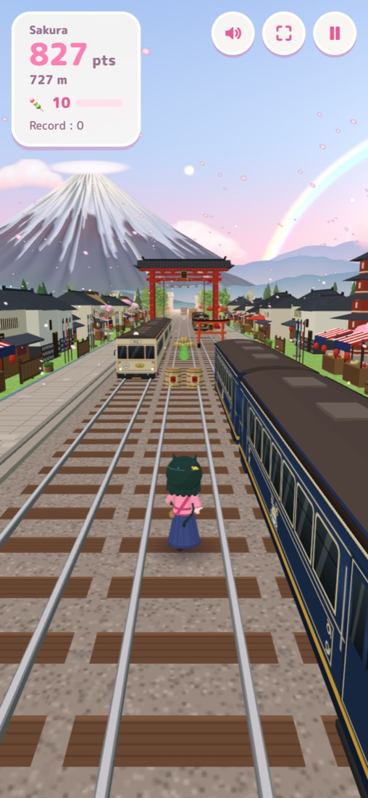
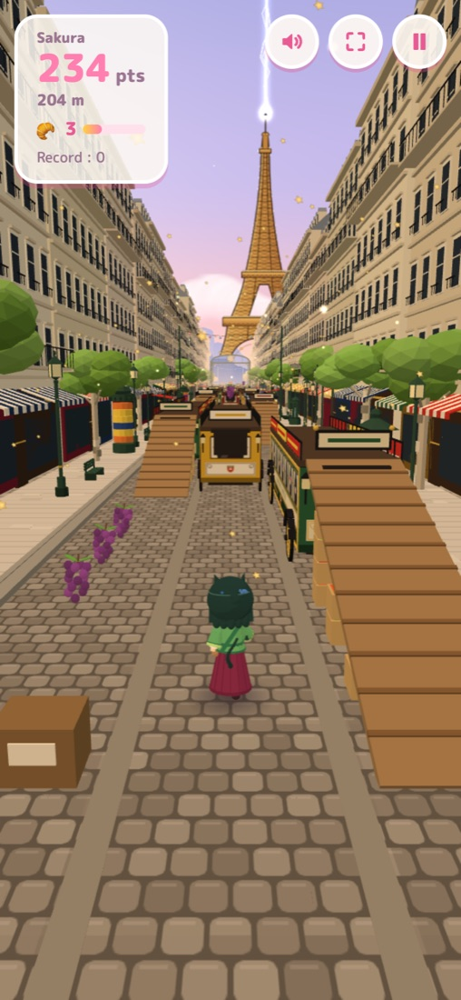
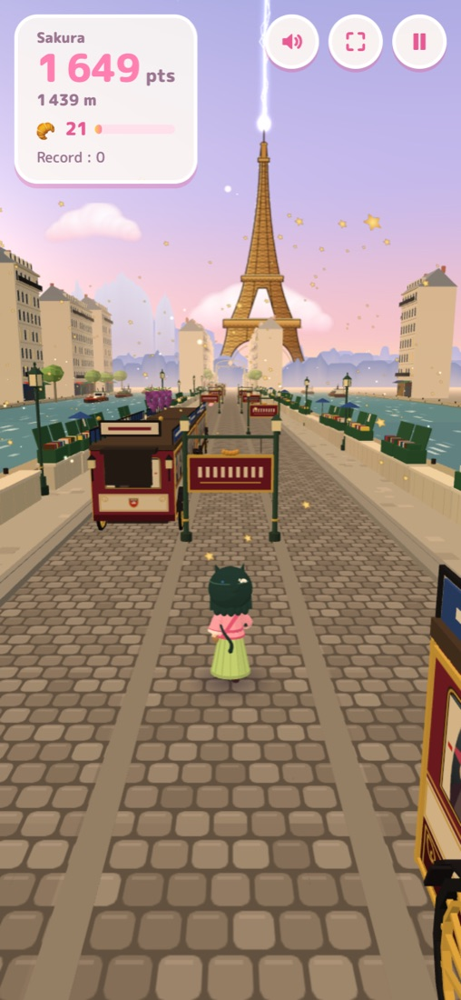
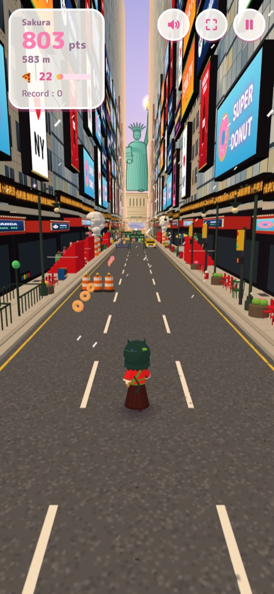
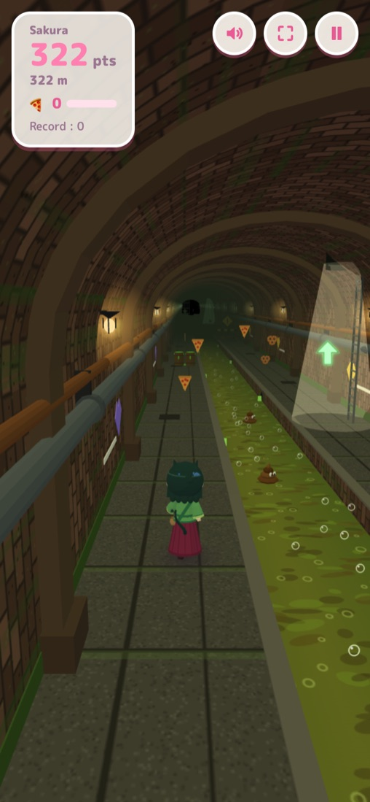

# Onima Run

Jeu de course infinie en 3D (inspiré de Subway Surfers) à travers le Japon traditionnel, le Paris de 1900 et New York, jouable sur ordinateur et téléphone.

**▶ Jouer en ligne : https://bertrandg.github.io/game-onima/**

<table>
  <tr>
    <td align="center"><br><sub>🗻 Japon : village et tramways</sub></td>
    <td align="center"><br><sub>🗼 Paris 1900 : boulevard</sub></td>
    <td align="center"><br><sub>🗼 Paris 1900 : quais de Seine</sub></td>
  </tr>
  <tr>
    <td align="center"><br><sub>🗽 New York : Times Square</sub></td>
    <td align="center"><br><sub>🗽 New York : les égouts</sub></td>
  </tr>
</table>

## Lancer le jeu

```bash
python3 serve.py
```

Puis ouvrir http://localhost:8080 (sur téléphone, même Wi-Fi : `http://<ip-de-l-ordinateur>:8080`).

Aucune installation nécessaire : Three.js est chargé depuis un CDN. Le jeu doit être servi en HTTP (pas en ouvrant `index.html` directement), à cause des modules JavaScript.

## Commandes

| Action | Clavier | Tactile |
| --- | --- | --- |
| Changer de voie | ← → (ou Q/D, A/D) | swipe gauche / droite |
| Sauter | ↑ (ou Z/W, espace) | swipe vers le haut |
| Roulade / retomber vite | ↓ (ou S) | swipe vers le bas |
| Pause | Échap ou P | bouton ⏸ |

## Niveaux

| Niveau | Univers | Déblocage |
| --- | --- | --- |
| 🗻 Japon | Campagne, villages et forêt du Japon traditionnel, mont Fuji | dès le départ |
| 🗼 Paris 1900 | Boulevards haussmanniens, marché, quais de Seine, tour Eiffel | 1 500 points au Japon |
| 🗽 New York | Wall Street, Times Square, Chinatown entre des gratte-ciel, statue de la Liberté ; taxis, bus touristiques et égouts | 2 300 points à Paris |
| 🐪 Égypte | Allée des sphinx et temples, bords du Nil, souk, pyramides de Gizeh ; blocs sur traîneaux, chars et tombeau | 3 000 points à New York |
| 🌃 Hong Kong | La nuit : néons de Mong Kok, marché de Temple Street, port Victoria et sa skyline ; minibus, taxis rouges et passerelles d'échafaudage | 3 500 points en Égypte |
| 🛍️ Centre commercial | Six étages de boutiques (mode, jouets, high-tech, sport, maison et livres, gourmandises sous la verrière) reliés par des escalators ; îlots-vitrines, petit train, caddies et soldes | 4 000 points à Hong Kong |

À New York, une bouche d'égout ouverte ne fait pas perdre : on tombe dans les égouts et la course continue sur deux quais,
de part et d'autre d'un canal de boue mortel. Pour changer de quai, il faut sauter (en l'air, un seul swipe fait passer de
l'autre côté du canal). En sautant au pied d'une échelle (rai de lumière et flèche verte), on remonte d'un bond à la surface.

En Égypte, une dalle effondrée de l'avenue fait tomber dans un tombeau peint (trois voies sous un plafond étoilé). On y saute
par-dessus sarcophages, trésors et momies (plus hautes : il faut sauter au bon moment), on passe en roulade sous les poutres
tombées et on évite les portes scellées. Pour ressortir, on monte en courant un escalier baigné de lumière (flèche dorée) qui
débouche sur l'avenue, sans s'arrêter. Le décor y est plus fin que dans les autres niveaux (statues et colonnes lissées et
peintes) tout en restant dans le même budget de dessin : trois matières seulement par tranche de décor (facettes, pièces
lisses peintes avec un atlas unique, flammes et ors lumineux), voir `js/levels/egypte/shapes.js`.

À Hong Kong, l'autre étage est au-dessus : des passerelles d'échafaudage de bambou courent à 5,4 m au-dessus des trois
voies, par tronçons de 120 à 240 m. On y monte par une rampe de planches (flèche rose) ou en sautant depuis le toit d'un
minibus (le plancher se traverse par en dessous et porte quand on retombe dessus). Là-haut : climatiseurs et plantes à
sauter, linge à passer en roulade, réservoirs d'eau à éviter, et des friandises en plus. Une planche manquante ou le bout
de la passerelle font retomber dans la rue, sans perdre ; la rue reste visible et continue en dessous. Le plancher est
dessiné par instanciation (un appel de dessin par matière quelle que soit sa longueur). Rien du décor ne descend sous
10,5 m au-dessus des voies (on saute depuis les passerelles) : le niveau le déclare (`clearance`) et les tests le vérifient.
Les rez-de-chaussée sont des boutiques en retrait sous l'auvent (pharmacie, café, produits séchés, électronique,
bijouterie, boulangerie, restaurant de dim sum, supérette, ou rideau de fer), chacune avec son caisson lumineux ; les
néons et les vitrines se reflètent sur le trottoir mouillé (matière additive `add` de l'atlas).

Au centre commercial, six étages sont superposés, chacun avec ses boutiques et ses obstacles. Des escalators relient deux
étages voisins : un escalator occupe une voie, et rester dans cette voie, c'est le prendre (flèche verte et panneau
« ▲ Étage n » pour monter, flèche orange « ▼ » pour descendre ; on ne change pas de voie pendant la montée). L'aborder par
le côté, c'est heurter sa balustrade. À l'étage où il arrive, sa voie est fermée par un totem publicitaire ou une cloison.
Plus on monte, plus il y a de friandises : le dernier étage, celui des gourmandises sous la verrière, en regorge. L'étage
en cours s'affiche sous le score. Chaque boutique a son style de façade (pierre et liseré doré, chêne, lattes de bois
sombre et laiton, brique blanchie et verrière d'atelier, store rayé, néons, cubes de couleur), son enseigne en lettres
lumineuses ou en caisson et une enseigne-drapeau ronde à son pictogramme, lisible depuis la galerie. Les dalles et les
boutiques sont dessinées par instances (rangées de six boutiques préparées au chargement) ; seuls l'étage du joueur et,
près d'un escalator, ses voisins sont affichés.

Quand on perd, pas de sang : une petite animation selon ce qui a fait perdre (rebond en arrière et étoiles après un choc
de face, chute à plat ventre sur un obstacle bas, tournoiement après un coup sur la tête, enlisement dans la boue des égouts,
évanouissement après un malus). Une fois l'héroïne allongée et apaisée, son âme s'envole au ciel dans un rai de lumière,
sur une petite musique d'espoir ; un toucher ou une touche passe directement à l'écran de fin.

Chaque niveau a son propre tableau des scores. Sur l'accueil, les flèches font défiler les niveaux, avec le décor 3D du niveau choisi.
Un niveau n'est téléchargé qu'au moment où on le choisit.

### Ajouter un niveau

1. Créer un module dans `js/levels/` (voir `japon.js` ou `paris/index.js`) qui exporte par défaut :
   - `fog`, `music` (gamme, mesure, tempo, instrument `koto`, `musette` ou `jazz`) ;
   - `world` : `decor` (catalogue d'éléments, thèmes de zones, `prebuild` qui renvoie le grand portail et la guirlande),
     `lights`, `track` (textures du sol et de la voie, marquage au sol), `particles`, `scenery(root)` (ciel et lointain) ;
     les éléments de décor peuvent avoir des panneaux texturés (`TexBuilder`, matériaux dans `decor.texMats`) ;
   - `obstacleKit()` : véhicules (`buildVehicle`, taille propre possible), rampe, obstacles bas et haut, attelage éventuel ;
   - `obstacles(root, opts)` (facultatif) : moteur d'obstacles propre au niveau (ex. les deux étages rue / égouts de New York, rue / passerelles de Hong Kong, les six étages du centre commercial) ;
     il peut fournir `hudText` (une ligne sous le score) ;
   - `world.decor` et `world.track` peuvent valoir `null` quand le moteur construit lui-même le décor (centre commercial) ;
   - `clearance` (facultatif) : hauteur libre au-dessus des voies que le décor doit respecter (4,5 m par défaut) ;
   - `items()` : objets à ramasser et malus.
2. L'ajouter dans `js/levels/index.js` avec son nom, son icône, son objet et sa condition de déblocage.

## Tests

Les tests n'ont besoin que de Node (22 ou plus) et de Google Chrome installé ; le jeu, lui, reste sans installation.

```bash
npm install
npm test            # quelques secondes : règles du jeu, génération des parcours, scores, déblocage, imports
npm run test:load   # dans Chrome : chaque niveau se charge et démarre sans erreur
npm run test:e2e    # dans Chrome (environ 3 min) : parcours joués, budgets de performance
npm run test:all    # les trois, à lancer avant d'envoyer une modification
```

- `tests/unit/` : tests lancés dans Node. Les modules du jeu y sont chargés tels quels, avec un faux
  `localStorage`, un faux `document` (les textures sur canvas sont dessinées « à vide ») et un hasard
  rejouable (`seed(n)` dans `tests/helpers/env.mjs`).
  - `generation.test.mjs` génère des parcours de 4 km avec plusieurs graines et vérifie qu'ils restent
    jouables : jamais trois voies fermées, assez d'espace entre deux obstacles, friandises et malus bien
    placés, un seul taxi qui roule, bouches d'égout sur les côtés, décor hors de la chaussée…
  - `sewer.test.mjs` : chute, boue, rats, échelles (y compris le saut un peu trop tôt).
  - `tomb.test.mjs` : dalles effondrées, obstacles du tombeau, montée de l'escalier jusqu'à l'avenue.
  - `scaffold.test.mjs` : rampes et sauts vers les passerelles, obstacles d'en haut, planches manquantes.
  - `mall.test.mjs` : escalators réguliers à chaque étage, voies dégagées autour, montée et descente, balustrade,
    voie fermée à l'arrivée, plafond, et davantage de friandises en montant.
- `tests/e2e/` : tests dans Chrome (Playwright), sur la page ouverte avec `#debug`.
  - `scenarios.test.mjs` : de vraies parties sans invincibilité ; la route est vidée, on y pose les
    obstacles voulus et on appuie sur les touches au bon moment (saut, roulade, rampe, égouts aller-retour,
    déblocage de New York, tombeau d'Égypte, passerelles de Hong Kong, escalators du centre commercial…). Les outils de pilotage sont dans `tests/helpers/game.mjs`.
  - `perf.test.mjs` : chaque niveau se joue 700 m sans erreur ni fichier manquant ; budgets d'appels de dessin et de triangles par niveau, et pas de fuite de mémoire
    graphique. Si un ajout de décor les dépasse, alléger le décor ou relever le budget en connaissance de cause.
- `tests/load/` : chargement de chaque niveau dans Chrome.
- Sur GitHub, chaque envoi lance `npm test` et `npm run test:load` ; le site n'est mis en ligne que s'ils
  passent. Sans carte graphique, le rendu y est trop lent pour jouer : `npm run test:e2e` se lance donc
  sur l'ordinateur, avant d'envoyer.

À chaque nouvelle règle (« un seul taxi qui roule », « rats immobiles »…), ajouter le test qui la vérifie.

## Structure

- `js/main.js` : boucle de jeu, états, menus, caméra, physique du joueur
- `js/obstacles.js` : trains, rampes, barrières, génération et collisions
- `js/world.js` + `js/decor.js` : voie, décor (rizières, villages, bambous, pagodes, torii, mont Fuji…)
- `js/girl.js` : le personnage et ses animations
- `js/audio.js` : sons et musique générés (WebAudio)
- `js/scores.js` : tableaux des scores par niveau (stockés dans le navigateur)
- `js/levels/` : registre des niveaux et contenu de chaque niveau (`japon.js`, `paris/`, `newyork/`, `egypte/`, `hongkong/`, `mall/`)
- `js/config.js` : réglages (vitesse, saut, tailles…)

Ajouter `#debug` à l'URL expose `window.__onima` pour les tests.

## Crédits

Illustration de la statue de la Liberté (niveau New York) : [Vecteezy.com](https://www.vecteezy.com).
Revolver (malus de New York) : « Survival Pack » de [Quaternius](https://quaternius.com), licence CC0.
Végétation, étals et potagers du Japon (feuillus, cèdres, rochers, stands, charrettes, légumes) : modèles de
[Quaternius](https://quaternius.com) et [Kenney](https://kenney.nl) trouvés sur [Poly Pizza](https://poly.pizza), licence CC0 (`models/japon/`, détail dans `models/japon/LICENSE.txt`).
Platanes, cagettes, tonneaux, pains et barques de Paris : même provenance (`models/paris/`, détail dans `models/paris/LICENSE.txt`).
Arbres, bouches d'incendie, bancs, poubelles, bennes et cagettes de New York : modèles de Quaternius, même provenance
(`models/newyork/`, détail dans `models/newyork/LICENSE.txt`).
Banians, cagettes, ananas, tabourets, bancs, climatiseurs et feux de Hong Kong : modèles de Quaternius, Kenney et Kay Lousberg, même provenance ;
chaussée et trottoirs : photos de [Poly Haven](https://polyhaven.com), licence CC0 (`models/hongkong/`, détail dans `models/hongkong/LICENSE.txt`).
Palmiers dattiers d'Égypte : trois « Palm Tree » de Quaternius, même provenance, simplifiés et recolorés
(`models/egypte/`, détail dans `models/egypte/LICENSE.txt`).
Plantes d'intérieur, mannequins de couturière et bancs du centre commercial : modèles de Quaternius et reyshapes, même
provenance ; parements des façades (marbre, chêne, lattes, brique blanchie) et sol : photos de
[Poly Haven](https://polyhaven.com), licence CC0 (`models/mall/`, détail dans `models/mall/LICENSE.txt`).
Chevaux au galop des fiacres de Paris et des chars d'Égypte : « Horse » de Quaternius (CC0), avec son squelette et son
animation, harnais ajouté dans Blender (`models/horse/`, détail dans `models/horse/LICENSE.txt` ; couleurs dans `js/horses.js`). Simplifiés et
convertis dans Blender par `tools/export-plants.py`, puis recolorés dans le jeu (`js/plants.js`) : ils se fusionnent dans
le décor sans appel de dessin supplémentaire.
Façades de New York : pièces du « Downtown City MegaKit » (version Standard) de [Quaternius](https://quaternius.com), licence CC0
(`models/nykit/`). La texture des étages supérieurs (`models/nykit/facades.jpg`) se régénère en ouvrant
`tools/bake-facades.html` via `serve.py`.
