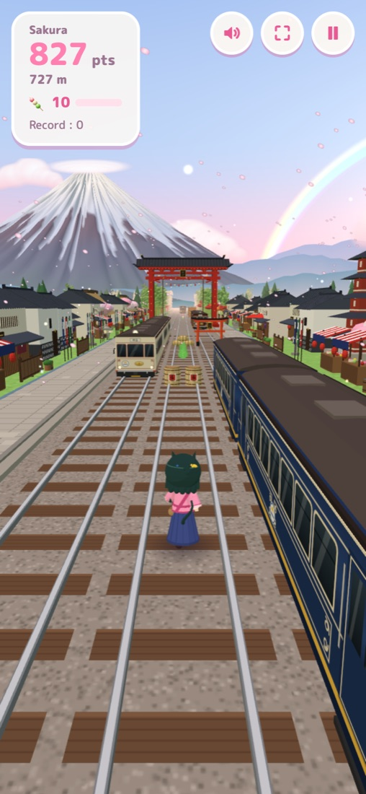
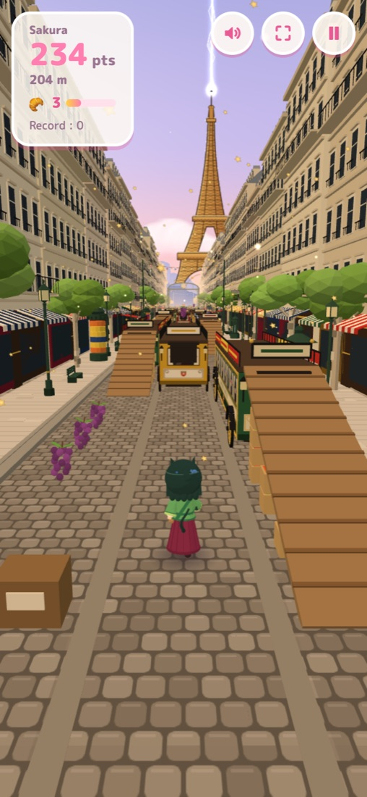
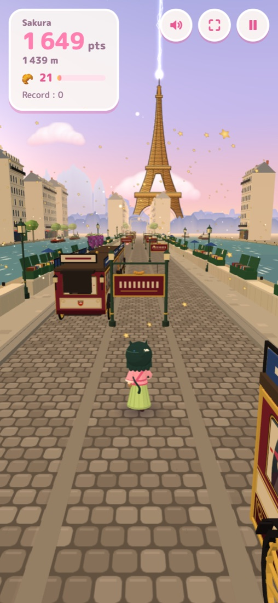
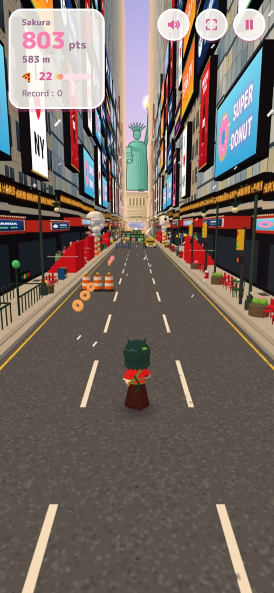
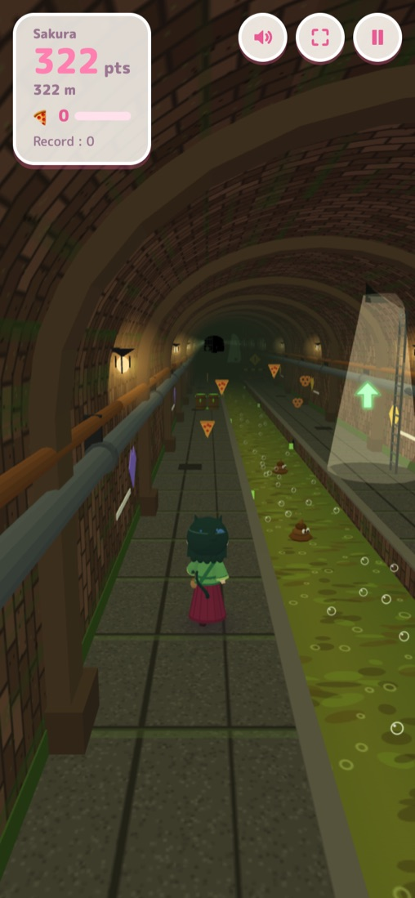

# Onima Run

Jeu de course infinie en 3D (inspiré de Subway Surfers) à travers le Japon traditionnel, le Paris de 1900 et New York, jouable sur ordinateur et téléphone.

**▶ Jouer en ligne : https://bertrandg.github.io/game-onima/**

<table>
  <tr>
    <td align="center"><br><sub>🗻 Japon : village et tramways</sub></td>
    <td align="center"><br><sub>🗼 Paris 1900 : boulevard</sub></td>
    <td align="center"><br><sub>🗼 Paris 1900 : quais de Seine</sub></td>
  </tr>
  <tr>
    <td align="center"><br><sub>🗽 New York : Times Square</sub></td>
    <td align="center"><br><sub>🗽 New York : les égouts</sub></td>
  </tr>
</table>

## Lancer le jeu

```bash
python3 serve.py
```

Puis ouvrir http://localhost:8080 (sur téléphone, même Wi-Fi : `http://<ip-de-l-ordinateur>:8080`).

Aucune installation nécessaire : Three.js est chargé depuis un CDN. Le jeu doit être servi en HTTP (pas en ouvrant `index.html` directement), à cause des modules JavaScript.

## Commandes

| Action | Clavier | Tactile |
| --- | --- | --- |
| Changer de voie | ← → (ou Q/D, A/D) | swipe gauche / droite |
| Sauter | ↑ (ou Z/W, espace) | swipe vers le haut |
| Roulade / retomber vite | ↓ (ou S) | swipe vers le bas |
| Pause | Échap ou P | bouton ⏸ |

## Niveaux

| Niveau | Univers | Déblocage |
| --- | --- | --- |
| 🗻 Japon | Campagne, villages et forêt du Japon traditionnel, mont Fuji | dès le départ |
| 🗼 Paris 1900 | Boulevards haussmanniens, marché, quais de Seine, tour Eiffel | 1 500 points au Japon |
| 🗽 New York | Wall Street, Times Square, Chinatown entre des gratte-ciel, statue de la Liberté ; taxis, bus touristiques et égouts | 1 500 points à Paris |

À New York, une bouche d'égout ouverte ne fait pas perdre : on tombe dans les égouts et la course continue sur deux quais,
de part et d'autre d'un canal de boue mortel. Pour changer de quai, il faut sauter (en l'air, un seul swipe fait passer de
l'autre côté du canal). En sautant au pied d'une échelle (rai de lumière et flèche verte), on remonte d'un bond à la surface.

Chaque niveau a son propre tableau des scores. Sur l'accueil, les flèches font défiler les niveaux, avec le décor 3D du niveau choisi.
Un niveau n'est téléchargé qu'au moment où on le choisit.

### Ajouter un niveau

1. Créer un module dans `js/levels/` (voir `japon.js` ou `paris/index.js`) qui exporte par défaut :
   - `fog`, `music` (gamme, mesure, tempo, instrument `koto`, `musette` ou `jazz`) ;
   - `world` : `decor` (catalogue d'éléments, thèmes de zones, `prebuild` qui renvoie le grand portail et la guirlande),
     `lights`, `track` (textures du sol et de la voie, marquage au sol), `particles`, `scenery(root)` (ciel et lointain) ;
     les éléments de décor peuvent avoir des panneaux texturés (`TexBuilder`, matériaux dans `decor.texMats`) ;
   - `obstacleKit()` : véhicules (`buildVehicle`, taille propre possible), rampe, obstacles bas et haut, attelage éventuel ;
   - `obstacles(root, opts)` (facultatif) : moteur d'obstacles propre au niveau (ex. les deux étages rue / égouts de New York) ;
   - `items()` : objets à ramasser et malus.
2. L'ajouter dans `js/levels/index.js` avec son nom, son icône, son objet et sa condition de déblocage.

## Structure

- `js/main.js` : boucle de jeu, états, menus, caméra, physique du joueur
- `js/obstacles.js` : trains, rampes, barrières, génération et collisions
- `js/world.js` + `js/decor.js` : voie, décor (rizières, villages, bambous, pagodes, torii, mont Fuji…)
- `js/girl.js` : le personnage et ses animations
- `js/audio.js` : sons et musique générés (WebAudio)
- `js/scores.js` : tableaux des scores par niveau (stockés dans le navigateur)
- `js/levels/` : registre des niveaux et contenu de chaque niveau (`japon.js`, `paris/`, `newyork/`)
- `js/config.js` : réglages (vitesse, saut, tailles…)

Ajouter `#debug` à l'URL expose `window.__onima` pour les tests.
